# Reviewing an assistant integration before it is exposed: a weak and a hardened MCP server, one attack suite

<picture>
  <source media="(prefers-color-scheme: dark)" srcset="demo/diagrams/container-dark.svg">
  
</picture>

An assistant connected to a system will be fooled: text in a document, a tool result or a tool description can steer it, and no
prompt reliably prevents that. So the rules have to live in the system, not in the model. Two MCP servers expose the same
invented support desk, one weak on purpose and one hardened, and one attack suite runs against both. The attacker is a scripted
assistant that obeys every instruction it reads, so every run is deterministic: the weak server fails **all ten controls**, the
hardened one passes **all ten**, each with the test that decides it.

| Where | What |
|---|---|
| [docs/public/threat-model.md](docs/public/threat-model.md) | The threats, where each is stopped and the test that shows it |
| [reports/rubric.md](reports/rubric.md) | The rubric: pass or fail per control, each with its evidence |
| [docs/current/features.md](docs/current/features.md) | The desk's rules on each server, the gateway, the assistant |
| [demo/](demo/README.md) | Diagrams, evidence frames, the figures and one recorded run with a local model |
| [docs/current/verification.md](docs/current/verification.md) | How to run the suite and what the last run showed |

The ten controls: a key narrows its user's access and never widens it; above the tier ceiling the answer is "not found", the same as
for a missing document; a key cannot approve its own proposal unless granted, and the approver is recorded; approval follows a risk
class per path; planted instructions gain no authority; per-key limits stop slow extraction; every call is audited and a session
can be reported; a token can be revoked mid-session; a changed tool description is detected; data read from a higher tier does not
flow into a write on a lower one.

The rating is a rubric, not a score: one number is easy to game. Beside it are the operating questions an integration must answer
before it is exposed: who owns each key, who approves which paths, how long the audit log is kept, how a key is revoked and rotated,
and which servers an assistant is connected to.

You need Python 3.11 or later; nothing else.

```bash
make install && make test   # 37 tests, about 3 seconds; no network, no model, no database
make rubric                 # writes reports/rubric.md
make queue                  # the approval queue under two policies
```

The hardened server was written to pass, so the results show that each control can be implemented and tested, not that any
product has it; the repository rates only its own two servers. A local model (gpt-oss:20b) followed a planted instruction to send
a record out in 2 of 17 runs on the weak desk and never tried it on the hardened one, so the hardened side of that frame is a replay
of the model's own calls.

The desk, its company and its tickets are fictional (`example.test` addresses). The test harness is MIT-licensed ([LICENSE](LICENSE)).

---

**Daniel Colaço**, Software Architect: diagnosis, modernization and performance · [danielcolaco.pt](https://danielcolaco.pt/en/)

Written up in [How do you let AI assistants into a system without handing them the keys?](https://danielcolaco.pt/en/articles/giving-ai-assistants-access/)
