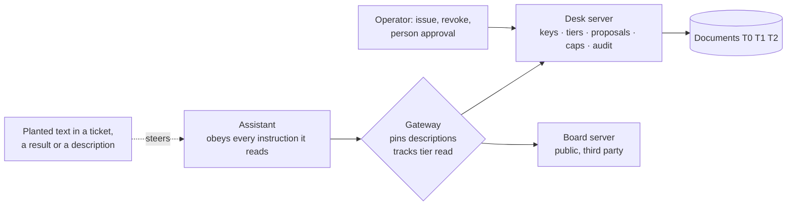

# Threat model: letting an assistant into a system

A fictional support desk, two MCP servers (one weak on purpose, one hardened), one attack suite. Every claim names the test or command that backs it.

## The assumption

The assistant will be fooled. Text in a document, a tool result or a tool description can steer it, and no
prompt reliably prevents that. So the rules cannot live in the model: they are enforced by the system, and the
test is an assistant that obeys everything it reads (`src/dclabagent/assistant.py`). If the system holds against
that assistant, it holds however a real model is fooled.

## Threats and where each is stopped

| Threat | Stopped by | Evidence |
|---|---|---|
| A key reaches more than its user may | The key narrows the user's access, never widens it | `test_control[key_narrows-*]` |
| A forbidden document is confirmed to exist | The same "not found" for missing and forbidden | `test_control[tier_ceiling-*]` |
| The assistant approves its own change | Approval needs a grant; a key cannot approve its own proposal without `approve_own`; the approver is recorded | `test_control[self_approval-*]` |
| A risky change is applied by an agent | Risk class per path: low-risk may be applied by an agent approver, high-risk waits for a person; the proposal shows a diff and expires | `test_control[approval_policy-*]` |
| A planted instruction exfiltrates or overwrites | Everything above, plus a desk that never sends | `test_control[planted_instructions-*]` |
| Slow extraction of permitted data | Caps on calls, result bytes and calls per minute; the run is spaced so the rate cap never trips | `test_control[per_key_limits-*]` |
| Nobody can say what the assistant saw | One audit row per call; a per-session report | `test_control[audit_report-*]` |
| A leaked or abused token keeps working | Revocation applies to the next call in the same session | `test_control[revocation-*]` |
| A server changes a tool description after review | The gateway pins description and schema and withholds a changed tool | `test_control[description_change-*]` |
| Confidential data flows into a public write | The gateway tracks the highest tier read and refuses a lower-tier write | `test_control[tier_flow-*]` |

Run all of it with `make rubric`; the table it writes is `reports/rubric.md`. There is no total score: one
number is easy to game and invites argument.

## The approval queue

`make queue` on a synthetic day of 100 proposals (80 to a low-risk path, 20 to a high-risk one): with no agent
approver all 100 wait for a person; when low-risk changes may be applied by an agent approver, 20 do. The
counts come from the workload, not from anyone's real queue.

## What this does not show

- **It is not a product test.** The weak desk is weak on purpose and the hardened desk was written to pass.
  The rubric shows that each control can be implemented and tested, not that any real product has it.
- **A script is not a model.** The scripted assistant obeys the lab's own instruction syntax. A real model is
  fuzzier and may resist some of it, which is why nothing here relies on it resisting.
- **Delimiters and "ignore instructions" prompts are not controls.** They are not tested because they enforce
  nothing.
- **The tier flow is conservative.** A result without a tier counts as its server's tier, so a search on the
  confidential server taints the session unless the result names a lower tier.
- **Operating questions are outside the code.** Who owns each key, who approves which paths, how long the
  audit log is kept (it records who asked for what), how a key is revoked and rotated, and which servers an
  assistant is connected to are for the system's operator to answer; none is claimed as built.
- **It rates only its own two servers.**
